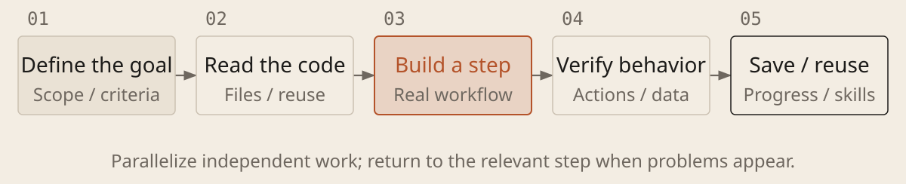

[English](../en/00-overview.md) · [简体中文](../zh/00-overview.md) · [Home](../../README.md)

# From an Idea to a Usable Result

Describe a goal in natural language. Let a coding agent read the project, edit files, run checks and improve the result. The agent repeatedly uses tools and chooses its next step from what it observes.

## One workflow, with methods added as needed

Clarify the goal, research existing solutions, then ask AI to implement, check and revise. Keep requirements, evidence and progress in project files; add collaboration and automation when useful. Understand what each method solves and when to use it. AI can help look up the tool-specific steps.

| Current situation | What to do |
| --- | --- |
| The idea is still vague | Clarify scope and acceptance criteria; plan a minimal usable version |
| Starting or changing a project | Read the project, reuse existing work, make a small change and run it |
| The result is wrong | Check the real workflow, keep error evidence and diagnose before fixing |
| Several independent tasks | Investigate in parallel; coordinate edits and review important results independently |
| Work is interrupted or repeated | Save progress, capture reusable methods, then consider batch execution |

## How to use the shaded prompt boxes

1. **Find and copy.** Each large shaded box in a chapter contains a prompt. Choose one for your task and copy all the text below its title.

1. **Replace the brackets.** Fill in placeholders such as “[goal]” with your requirements, for example: “Add a to-do item and keep it after a refresh.”

1. **Paste and send.** Open the project in Codex or Claude Code, send the completed prompt in the chat, then run and check the result as directed.

## Where human judgment matters

People decide goals, trade-offs and whether to accept the result; AI compares options, executes and provides evidence. Here, *taste* means understanding users and setting priorities. A demo may emphasize presentation; a daily-use tool may prioritize reliability. Meet essential requirements before balancing experience, cost and speed. Express preferences through scenarios, examples and observable criteria, and check whether those criteria fit the task.
