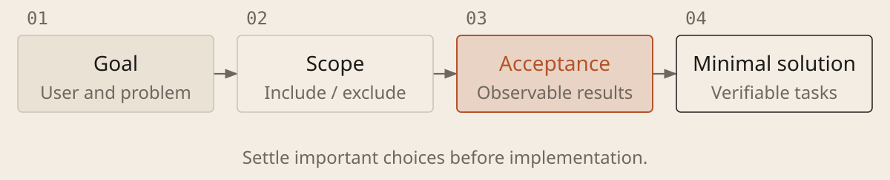

[English](../en/01-define-the-task.md) · [简体中文](../zh/01-define-the-task.md) · [Home](../../README.md)

# Turn an Idea into an Actionable Task



## Describe the result first

1. **State the goal and its basis.** Say who will use it and what they need to do. Include existing materials or references you approve of. Describe the outcome without prescribing every technical step.

1. **Set the scope of version one.** Separate what must work now from what can wait. If the idea is vague, let AI ask one key question at a time to clarify scenarios, boundaries and trade-offs. Do not repeatedly reconfirm settled requirements.

1. **Agree on acceptance criteria.** Replace “usable, complete, professional” with observable behavior: which operations must succeed, how failures should be handled and what must stay unchanged. Check for missing requirements before planning implementation.

### Clarify Requirements and Propose a Minimal Solution

```text
I want [users] to accomplish [goal] in [scenario]. The project and reference materials are at [location; say if none exist]. This version must include [scope] and exclude [out of scope]. You may edit [allowed scope].

Check the current state and preserve the original requirements. In the existing requirements document or the current feature's spec.md, record the goal, key user actions, acceptance criteria, behavior to preserve and open questions. Verify what you can; ask about unclear requirements one at a time, offer recommendations and label unconfirmed assumptions.

Propose a minimal solution and small tasks with a check for each. This round is for requirements and an initial outline, not code changes; defer technical choices until research. Follow existing documents or Spec Kit steps. Report inaccessible materials; if you cannot write files, return a draft without claiming it was saved.
```

## Keep important choices with people; leave room for implementation

A specification (spec) states goals, behavior, constraints and acceptance criteria; a plan explains the proposed implementation. Discuss the idea first, then write the spec. People review goals, trade-offs and acceptance; research informs the technical design. Clear criteria help execution but do not guarantee correct interpretation or implementation. A small, well-defined change may need only a short instruction rather than a long plan.
