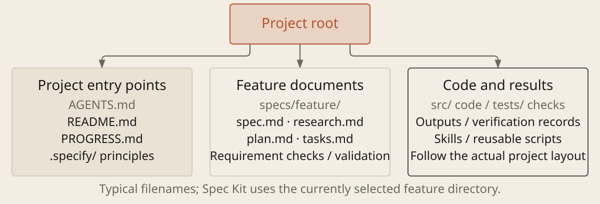

[English](../en/02-project-files.md) · [简体中文](../zh/02-project-files.md) · [Home](../../README.md)

# Connect Project Files and Responsibilities



Files preserve requirements beyond the chat. A trailing / in the diagram means a folder; `.md` is readable Markdown text. `README.md` explains how to run and check the project. `AGENTS.md` is a rules format supported by agents such as Codex. Direct loading in Claude Code depends on version and configuration; `CLAUDE.md` can also import it with `@AGENTS.md`. `.specify/` stores project principles and workflow support; feature requirements belong in the active feature directory.

| File | Questions it answers |
| --- | --- |
| `spec.md` | What to build, what to exclude and what counts as done; preserve original wording or a traceable link |
| `research.md` | What was investigated, sources, alternatives, rationale and remaining unknowns; link experiment records |
| `plan.md` / `tasks.md` | Implementation approach; ordered tasks, status and checks |
| `PROGRESS.md` | Actual progress across sessions, unfinished work and where to resume |
| Verification records | What ran, against which version, results and failure evidence |

### Organize Project Files and Reading Entry Points

```text
Project: [path]. Task: [goal]. Documents you may update: [scope]. Locate the existing rules, requirements, research, plan, tasks, progress and evidence. Add files only when missing and useful. Use the active Spec Kit feature directory rather than creating parallel copies. Report unreadable paths; return a draft if you cannot write.

Keep rules limited to project-specific conventions, edit scope, check commands and document pointers. Use a short index linking research and experiments to their originals. Preserve valid content; do not move or delete originals. List updated paths and when to maintain them. Refresh rules as the tool requires and check their loaded sources; if loading is not observable, mark it unverified. Creating a file does not prove it is active.
```

**Use an index to find information; keep originals as evidence.** Context compaction itself does not rewrite project files on disk. Save key information beforehand and make it accessible in later sessions. A file's existence does not mean the agent has read it. On resuming, reread the current spec, progress and relevant evidence. Update plans and tasks when requirements change, then record results. Small tasks can share one short record.
