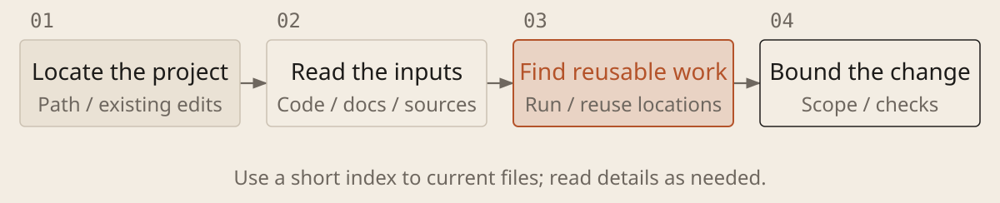

[English](../en/03-research-first.md) · [简体中文](../zh/03-research-first.md) · [Home](../../README.md)

# Understand the Project Before Changing It



## Research existing solutions before choosing an architecture

Open the right project. Inspect existing implementations and similar projects before choosing reuse, adaptation or a new build. Compare use cases, costs and limits using official documentation, original research and examples. Discuss module responsibilities, data flow and interfaces (agreements for exchanging data). Ask why the design fits and when it would not; build on existing work.

## Protect data before starting

1. **Use a test environment.** Work with data copies and test accounts; restrict file and network access. Isolate production when experimenting with broader permissions. Before deleting, publishing or changing production data, establish authorization, backups and recovery steps.

1. **Protect secrets.** Prefer a secrets manager. Restrict access to local `.env` files and never commit them or paste secrets into chat or client-side code. `.gitignore` does not untrack files, stop AI reads or erase history. Revoke and replace leaked credentials.

1. **Inspect unfamiliar content.** Instructions in a page or file that divert AI from its task are prompt injection. Avoid combining access to private data with outbound or deletion permissions when reading untrusted content. Check the origins of third-party skills, scripts and packages.

### Read the Project and Identify the Change

```text
Goal: [task]. Materials: [location]. Research file you may update: [path]. Check the version, existing changes, rules and runtime requirements. Do not change the program this round; validate only in a test environment. Report unreadable materials; return a draft if you cannot save records.

Find existing implementations and comparable solutions. Compare reuse, adaptation and a new build. Verify package names, official sources and licenses. If offline, label external claims unverified; do not invent sources. Run minimal experiments on architecture-relevant unknowns and explain modules, data flow and dependencies.

Record questions, sources and check dates, observations, alternatives, rationale and unknowns. Separate established facts, inferences and hypotheses; say what new evidence would change the choice. Report actual edits and unverified items. Preserve original materials and verification evidence.
```

## Make research inform a decision

Context is the information AI can currently access; provide it as needed. Research should answer what can be reused, why it fits and what still needs validation, then inform the plan. A file's presence does not prove it was read. A tool running locally may still send information to a cloud model.
