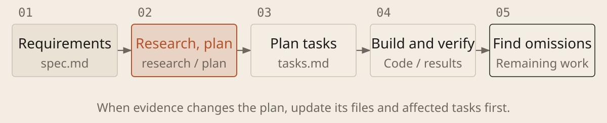

[English](../en/04-spec-kit.md) · [简体中文](../zh/04-spec-kit.md) · [Home](../../README.md)

# Connect Specs and Execution with Spec Kit



A spec describes requirements. [Spec Kit](https://github.com/github/spec-kit) is an optional open-source tool for organizing specs, plans and tasks. Understand the method before adopting the tool; a short note can be enough for a small change.

## Steps and files: check your installed version

| Step | Purpose and what to check |
| --- | --- |
| `constitution` | Set principles in `.specify/memory/constitution.md` |
| `specify / clarify` | Define requirements, resolve ambiguity and maintain `spec.md` |
| `plan` | Record research in `research.md` and the approach in `plan.md` |
| `checklist` | Check requirements quality as needed; passing is not implementation |
| `tasks / analyze` | Create `tasks.md`; check consistency with requirements and plans |
| `implement` | Execute tasks, run checks and keep results |
| `converge` | Find omissions and add remaining work; still verify actual behavior |

`plan` also produces `data-model.md` (data structure) and `quickstart.md` (validation steps), with `contracts/` for external interfaces where applicable.

Current default skill invocation: Codex uses `$speckit-specify`; Claude Code and Copilot use `/speckit-specify`. The active feature is selected by `.specify/feature.json` or runtime settings, not automatically by switching Git branches.

### Advance the Current Feature with Spec Kit

```text
Project: [path]. Basis: [requirements and records]. Step for this round: [step]. Allowed edits: [scope]. Check the installed version, invocation, active feature and prerequisites. If installation or inputs are missing, propose how to supply them; do not install or skip ahead on your own.

Preserve existing files. Clarify ambiguity and investigate unknowns. Include required automated tests in the spec and tasks; map each task to requirements and checks.

If only the user can invoke the step, provide the command and wait for its result. Report actual outputs, checks, conflicts and the next step. Do not claim an uninvoked step ran. Surface contradictory requirements rather than choosing silently.
```

When unsure, have AI check the official instructions and actual invocation. People review goals and acceptance; AI implements tasks. Update the plan and checks when requirements change so new prompts do not overwrite prior agreements. Complete documentation does not prove a finished feature.
