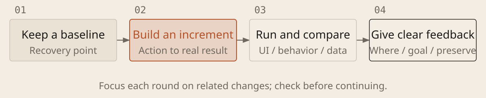

[English](../en/05-small-steps.md) · [简体中文](../zh/05-small-steps.md) · [Home](../../README.md)

# Build in Small Steps and Give Specific Feedback



## Complete one real user workflow at a time

1. **Keep a recoverable version.** Git records and compares versions. Protect existing changes, then use a branch (a separate line of development) for this round. After a checked increment, make a local commit explaining the change. A commit saves locally; a push uploads to a remote repository. Tool undo history is not a substitute for version control.

1. **Connect one real path first.** Let a user reach an actual result from the first action, and persist anything that must be saved before adding features. For a UI, preview the layout before connecting real data; a finished preview is not a working feature.

1. **Give feedback on what you see.** Provide screenshots or references. State the location, current behavior, desired behavior and what must stay unchanged. Focus each round on related issues, then reopen and check.

### Implement One Verifiable Increment

```text
Project and requirements: [location; state requirements if no document exists]. Complete [feature scope] using [key checkpoints]. You may edit [scope]. Preserve [behavior and style]. References: [files or screenshots; say if none].

Inspect existing changes and keep a recoverable baseline using version history or a backup; exclude unrelated work. Implement, check and fix against [runnable acceptance checks] within [budget]. Report missing key inputs. Pause affected work for unauthorized actions, important trade-offs or repeated failures with no new lead. Connect the entry point, processing, persistence and feedback. Label mock data, unfinished features and hard-coded answers.

Explain key changes and data destinations, with file locations. Run the project and provide an accessible address or path, check steps and actual results. For UI changes, click, type, refresh and compare screenshots; without tools, give manual steps and mark those checks unverified. Save this round separately; commit locally only if authorized, without pushing. Update tasks and progress. Use [location, current behavior, desired behavior, things to preserve] for the next change. Avoid unrelated rewrites; explain trade-offs before changing agreed goals.
```

## Each round should leave something worth keeping

The usable version saved before editing is the baseline. Keep its version, run instructions and check results before the next round; use the same criteria to compare old and new. Small changes help locate improvements and regressions, avoiding a rewrite that loses accepted behavior. Try the key workflow yourself before giving feedback. If the result is no better, restore the baseline or reduce the change.
