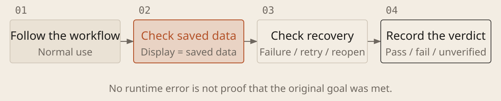

[English](../en/06-acceptance-checks.md) · [简体中文](../zh/06-acceptance-checks.md) · [Home](../../README.md)

# Judge Completion Through Actual Use



## Check what users will actually experience

| Area | Expected evidence |
| --- | --- |
| Normal use | Complete the goal from the real entry point; displayed and saved data agree |
| Errors and repetition | Missing input, failed operations and retries are handled without unintended duplicate effects |
| Reopening and recovery | Required data survives refreshes, restarts or interruptions; work can resume as agreed |
| Permissions and existing features | Unauthorized accounts cannot access or change data; related behavior still works |

### Run Acceptance Checks Against Requirements

```text
Check [project location and version] against [requirements and original materials]. Approved test environment and data: [scope]. List expected outcomes first; clarify important ambiguity. Do not treat current program output as the correct answer. This round is for acceptance, not changing implementation or weakening criteria.

Follow the complete real workflow. Compare displayed results with saved records. Based on risk, check failures, repetition, reopening, recovery and existing features. Add required tests only within scope; a regression check should expose the original error before passing after the fix. For accounts or public endpoints, check unauthorized access, exposed secrets and external input being executed as commands, within authorization.

For each requirement, report steps, expected and observed results, evidence, and pass, fail or unverified status. Identify mock data, substitute services and environment limits. Respect authorization for checks with external effects. If unable to run, give manual steps and mark gaps unverified. No error message is not proof of completion. Do not delete, skip or relax checks to obtain a pass; report conflicts between requirements and checks.
```

## Tie completion claims to verification results

An end-to-end check follows the user's workflow from start to finish. Establish that a check can detect a missing or wrong result before relying on its passing after a fix. Compare reports with original requirements and operational evidence; missing evidence remains unverified. AI-written code and tests can share the same misunderstanding. Working features are not necessarily secure: before real use, also inspect permissions, secrets in code and logs, and recovery procedures. Have an experienced person review important issues.
