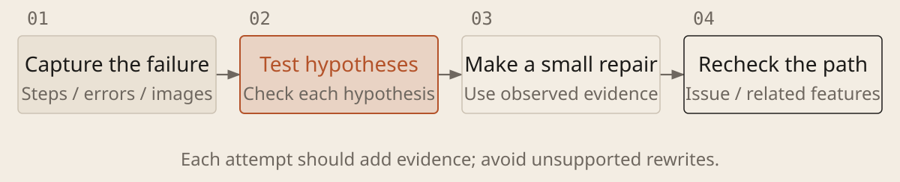

[English](../en/07-debugging.md) · [简体中文](../zh/07-debugging.md) · [Home](../../README.md)

# Diagnose Before Changing Code



## Turn a failure into useful evidence

1. **Preserve the full symptom.** Record steps, expected and actual outcomes, exact error messages with secrets removed, screenshots and recent changes. “It does not work” is not enough.

1. **Distinguish possible causes.** Have AI check paths, runtime settings, permissions and data, then propose causes and checks that distinguish them. Each attempt should add evidence.

1. **Fix only what the evidence supports.** Repeat the original action after a fix, then check related behavior. For intermittent failures, record attempts and failures; temporary disappearance does not prove the cause was resolved.

### Investigate a Specific Failure

```text
Problem: [steps, expected outcome, actual outcome]. Project and error records: [location]. Recent changes: [details; say if unknown]. Allowed repairs: [scope]. Investigation budget: [time or attempts].

Check the current version, runtime settings, permissions and files before rewriting. Reproduce in an approved test environment. If intermittent, record conditions, attempts and failures. Report missing inputs or tools; do not turn guesses into conclusions.

List possible causes and their predicted observations. Run minimal checks to find the earliest divergence. Preserve key experiments: hypothesis, version, conditions, action, result and evidence; keep unsuccessful paths too. Make a small repair only with supporting evidence and within scope. Where automated reproduction is possible, retain a check that fails before the fix and passes after it, then check related features. If an approach repeatedly fails or the budget is nearly spent, save facts and unknowns and consider an independent review. Return records if you cannot write them. Exclude sensitive information.
```

## Failure records are project assets

Reproducing means triggering the same error under the same conditions; a regression occurs when a change breaks existing behavior. Preserve failing examples, ruled-out causes and checks after a repair. Consult them when a similar issue returns to avoid repeating ineffective attempts. Earlier conclusions apply to their original conditions; a new version or environment may justify retesting. A regression check is more useful than a note saying “be careful next time.”
