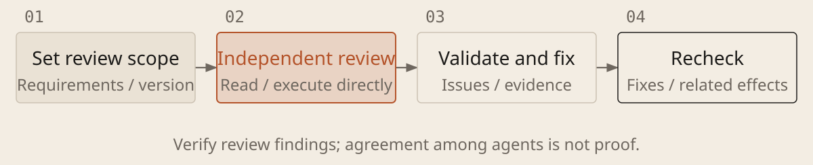

[English](../en/09-independent-review.md) · [简体中文](../zh/09-independent-review.md) · [Home](../../README.md)

# Get an Independent Agent Review



Arrange an independent review after important features, integration or before real use. The reviewer should read requirements and current files directly. Relying only on the implementer's completion summary can preserve the same misunderstanding.

## Separate implementation from review

1. **Fix the review scope and inputs.** Record the version, changes, requirements and run instructions. Prefer a fresh session or subagent without the implementation conversation, providing only necessary materials. Copying the old chat can import prior judgments.

1. **Report issues by impact.** Give location, trigger, expected and actual behavior, and evidence. Prioritize correctness, security and missing requirements. Keep stylistic preferences optional.

1. **Verify, repair and review again.** The implementer validates each finding; review the current version after fixes. Recheck conclusions affected by changes. Do not add complexity merely to answer every suggestion.

### Review Independently and Recheck Fixes

```text
Materials: [original requirements, current requirements, version, change scope and run instructions]. If you helped implement this and tools support it, assign a reviewer who did not participate and does not inherit the implementation conversation. Otherwise provide a handoff brief; you may self-review, but do not call it independent. List missing materials.

Do not edit the implementation under review. Read files first. If execution would write data, use an approved test copy or separate working directory with test data. If writes are prohibited, list checks not run; do not bypass restrictions. Separate directories do not isolate external data.

Check requirements, changes and evidence. Prioritize wrong results, data or permission issues, removed or weakened checks and broken existing behavior. For long-lived projects, also examine obvious duplication and complexity. Give each issue a location, trigger, impact and evidence; distinguish verified defects from risks.

Return a list for the implementer. Hand it off only with authorization and tools; otherwise let the user forward it. After fixes, recheck the current version and summarize resolved, outstanding and unverified items. State when no material issue was found within scope; do not invent findings to meet a quota.
```

## An independent perspective still needs evidence

A new reviewer is less attached to the work, but can make the same mistake. Validate triggers and evidence before repairs. Recheck affected areas and project-required checks afterward. Agreement among several AIs is not proof; ask an experienced person to judge important unresolved questions.
