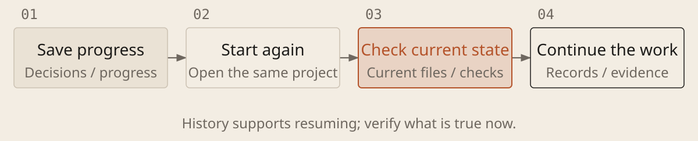

[English](../en/10-long-tasks.md) · [简体中文](../zh/10-long-tasks.md) · [Home](../../README.md)

# Resume Long Tasks Reliably



Long tasks need clear specs, staged acceptance and persistent records. Review a dependency-ordered queue of specs before execution. Save before interruptions, usage limits or repeated drift; verify the current state before resuming.

## Save before stopping; verify before resuming

`PROGRESS.md` is a text progress file; reuse an existing equivalent. Use the first prompt before ending a session and the second after restarting.

### Save Progress

```text
Update [progress file]: goals and decisions, project path and version, changed files and uncommitted edits, checks and evidence, failures and unverified items, unfinished work, recovery and next steps. If unable to write, return saveable text without claiming it is on disk.

Index key experiments with hypotheses, conditions, actions, results, abandoned approaches and reasons, and evidence links. Mark replaced decisions; preserve original requirements and evidence. Do not label plans completed. List each spec's status, dependencies and conditions to recheck. Mark missing history unknown rather than inventing it.
```

Update records after each verifiable stage. On resuming, reread the current spec, progress and relevant experiments. A chat claim of completion does not replace a traceable result.

### Read Progress and Continue

```text
Read [progress file], requirements, plan and tasks. Check the directory, version, existing edits and verification records. Without Git, compare file snapshots. Report missing or unreadable records before guessing progress; do not overwrite others' work.

Continue with the first actionable unfinished task, updating actual results after each verifiable increment. Reuse results only when related code, software, configuration and data are unchanged; recheck if uncertain. Still run the full checks required by the project.

Work within [allowed edit and execution scope] and [budget]. If blocked, advance independent work. Save before the budget runs out; return a handoff if unable to write. Pause affected work when goals must change, permissions must expand or an important unresolved choice needs a decision.
```

## Use acceptance criteria and stop conditions

Within a budget, let AI propose, execute, check and keep useful results without lowering acceptance criteria. Stop when done; save before limits. Pause affected work after repeated failures without new evidence or at unresolved trade-offs. Repetition does not guarantee convergence; restoring code does not undo external actions.
