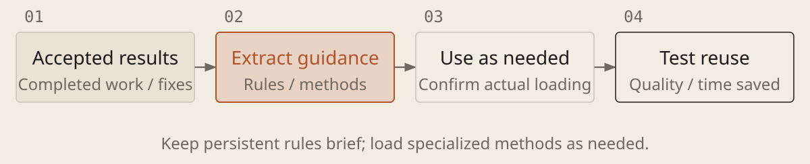

[English](../en/11-rules-and-skills.md) · [简体中文](../zh/11-rules-and-skills.md) · [Home](../../README.md)

# Turn Effective Methods into Rules and Skills



Capture useful methods when communication or mistakes repeat. Establish safety boundaries from the start; derive other rules from actual problems. More instructions increase reading overhead and do not guarantee accuracy. Test them on a new task.

## Keep three kinds of guidance distinct

| Form | What it holds and how to use it |
| --- | --- |
| Project rules | Special conventions, allowed scope, run and check commands; use recognized files such as `AGENTS.md`, not a full repository overview |
| Skills | Reusable methods, templates and materials; state when to invoke them, inputs and expected outputs |
| Automation | Scripts for stable steps; connect a supported Hook when they must run on a specified event |

### Extract Reusable Rules and Skills

```text
Derive reusable guidance from [accepted results, change records or repeated tasks]. Allowed updates: [file scope]. Reuse project rules. Package repeated methods as a Skill in the current tool's format, and fixed steps as scripts where useful. If Skills or writes are unsupported, return a draft; do not claim activation.

Define applicability, inputs, outputs, essential steps, verification entry points and failure handling. Inspect third-party skills and scripts before use. Preserve valid conventions and avoid unrelated installations.

Report paths and activation steps, including required review, trust, approval or restart. Validate with an authorized independent example; mark unexecuted checks unverified. For automatic checks, verify the trigger and behavior on success, failure and script errors without affecting real data.

Compare quality, communication and rework. Consolidate duplicate or outdated guidance only within scope. Mandatory checks must not depend solely on prompt reminders.
```

## Save standards, not every reasoning step

For example, “Local commits are allowed; pushing to a remote requires authorization” can be a project rule. A repeated research method can become a Skill. Test it on another similar task and remove obsolete guidance.

A configured Hook can call a script on tool-completion events to save commands, results and logs. Background tasks still need their actual exit status checked. A successful command is not acceptance. A logging-only Hook does not block actions. To prevent an action, verify the supported pre-action event and failure behavior in practice; post-action records cannot undo it.
