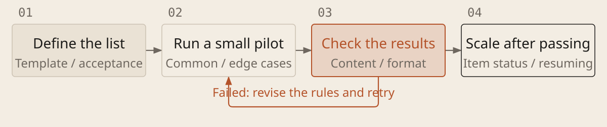

[English](../en/12-batch-work.md) · [简体中文](../zh/12-batch-work.md) · [Home](../../README.md)

# Pilot Repeated Work Before Scaling Up



When many files or tasks need the same treatment, make one-item processing reliable before increasing volume. Batch work repeats the same rules. Parallel execution is appropriate only when items are independent and cannot overwrite one another.

## Use a small pilot to establish the batch rules

1. **Define the list and format.** Specify each input, expected output, destination and acceptance criteria. Use a common template and preserve originals.

1. **Start with representative items.** Include common and difficult cases. Check content and format. When AI judgment is involved, repeat a few cases on test copies to assess consistency before scaling.

1. **Record each item and recover unfinished work.** Keep success, failure, skipped or uncertain status with reasons. Recheck affected items after rule, input or environment changes. Pause to fix the process when the same failure recurs.

### Pilot and Execute a Batch

```text
Process [task list] using [rules and template]. Output: [location]. Allowed operations and budget: [scope]. Pilot a few common and high-risk cases and show results with evidence. Repeat representative AI judgments to assess consistency. Clarify rules or acceptance criteria first; report missing tools without claiming processing occurred.

Give each item a unique ID, output format, source record and completion criteria. Parallelize only independent items. Do not overwrite originals or repeat external effects. Use copies or safely repeatable operations for repeated trials. Record status, output and failure reason. Check uncertain outcomes before retrying. Resume unfinished items; recheck affected results when inputs, rules or environment change.

Run required checks for every item, then sample actual content. Sampling does not replace required per-item checks. Scale only after the pilot passes and within authorization; pause scaling if a failure pattern repeats. Report the complete list and gaps, total time, human review and rework, not just generation speed.
```

## Fix the process before increasing volume

A small pilot catches errors before they are repeated many times. Review its results and settle the format and criteria first. At scale, reconcile the full list with results and gaps; retain failure reasons. Rule changes require rechecking affected items. A few good outputs do not prove the entire batch is complete.
