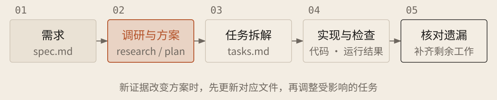

[English](../en/04-spec-kit.md) · [简体中文](../zh/04-spec-kit.md) · [Home](../../README.md)

# 用 Spec Kit 串起文件与执行



Spec 是需求规格；[Spec Kit](https://github.com/github/spec-kit) 是组织规格、方案与任务的可选开源工具。先理解方法，再按需选用；小改动用短记录即可。

## 步骤与对应文件：以安装版本为准

| 步骤 | 作用与需要检查的内容 |
| --- | --- |
| `constitution` | 建立项目原则，保存在 `.specify/memory/constitution.md` |
| `specify / clarify` | 写清需求、澄清歧义，维护 `spec.md` |
| `plan` | 调研写入 `research.md`，方案写入 `plan.md` |
| `checklist` | 按需检查需求质量；通过不等于功能已实现 |
| `tasks / analyze` | 生成 `tasks.md`；按需核对需求、方案、任务是否一致 |
| `implement` | 按任务实施，运行检查，保留结果 |
| `converge` | 实施后找遗漏、追加剩余任务；仍需实际验收 |

`plan` 还生成 `data-model.md`（数据组织）、`quickstart.md`（验证步骤）；有对外接口时生成 `contracts/`（接口约定），供实现与验收使用。

当前默认技能入口：Codex 用 `$speckit-specify`；Claude Code、Copilot 用 `/speckit-specify`。当前功能由 `.specify/“feature.json` 或运行设置指定，切换 Git 分支不会自动切换它。

### 按 Spec Kit 推进当前功能

```text
项目：[路径]，依据：[要求与记录]，本轮步骤：[步骤名]，允许修改：[范围]。核对安装版本、调用入口、当前功能和前置文件；未安装或前置缺失先给补齐方案，不擅自安装或跳步。

保留已有文件；澄清歧义，查证未知。需要自动测试时写入规格并拆成任务，每项对应需求与检查方法。

只有用户能调用时给出命令并等待执行结果。报告实际产物、检查、冲突及下一步；未调用不称已执行，要求矛盾不擅自取舍。
```

不熟悉命令时让 AI 查官方说明并核对入口。讨论后整理规格，人审核目标与验收，AI 按任务实施；需求变更同步方案与检查，避免新提示覆盖旧约定。文档齐全不等于完成。
