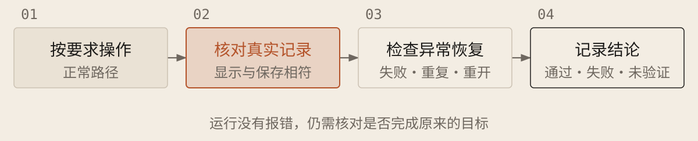

[English](../en/06-acceptance-checks.md) · [简体中文](../zh/06-acceptance-checks.md) · [Home](../../README.md)

# 从实际使用判断是否完成



## 检查用户真正会经历的情况

| 检查方向 | 需要看到的结果 |
| --- | --- |
| 正常操作 | 从实际入口完成目标，显示结果与实际保存内容相符 |
| 错误与重复 | 缺少必要输入、操作失败或重复执行时，有合理处理，不意外重复生效 |
| 重开与恢复 | 刷新、重启或中断后，应该保留的内容仍在，可以按约定继续 |
| 权限与原有功能 | 没有权限的账号不能读取或修改数据；相关已有行为仍正常 |

### 按需求运行验收

```text
根据[需求与原始材料]检查[项目位置与版本]，允许测试的环境与数据：[范围]。先列预期，重要歧义先确认，不抄程序输出作正确答案。本轮只验收，不改实现或放宽标准。

从真实入口走完整操作，核对显示与保存记录；按风险检查失败、重复、重开、恢复及旧功能。有测试需求时在获准范围补充检查；验证修复应能复现原错误，再在修复后通过。有账号或公开入口时，检查无权限访问、密钥暴露与外部输入被当命令执行的风险，禁止越权测试。

逐项报告操作、预期、观察、证据及通过、失败或未验证。注明模拟数据、替代服务和环境限制。检查有外部影响时遵守授权；缺工具或不能运行则列人工步骤与未验证项。不以没报错代替完成，不删、跳过或放宽检查换取通过；要求与检查冲突时说明。
```

## 把检查结果与完成承诺对应起来

端到端检查就是像用户一样从第一步做到最后，确认中间环节接得上。先确认检查能发现缺失或错误，再看修改后通过，才能知道它真能发现问题。收到报告时，对照要求查看操作证据；缺少证据仍是未验证。程序和 AI 自写的检查可能共享误解。功能正常也不代表安全；向真实用户开放前，另查权限、代码与记录中的密钥及恢复办法，重要问题请有经验的人复核。
