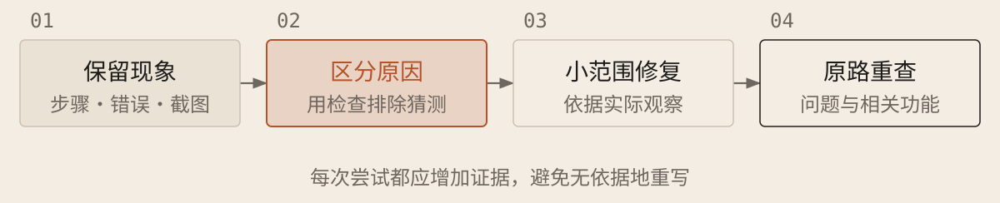

[English](../en/07-debugging.md) · [简体中文](../zh/07-debugging.md) · [Home](../../README.md)

# 出错时，先定位再修改



## 把一次失败变成可用线索

1. **保留完整现象。**记录操作步骤、预期与实际结果、错误消息原文（去掉密码、密钥等敏感信息）、相关截图，以及问题发生前的改动。不要只留下“不能用”。

1. **先区分原因。**让 AI 核对文件位置、运行设置、权限和数据，再提出可能原因及能区分它们的检查。每次尝试都应增加一条证据。

1. **只修证据指向的范围。**修复后重走原操作，再检查相关原有功能。偶发故障记录尝试次数和出错次数；暂时不再出现，不等于原因已经解决。

### 定向排错

```text
问题：[步骤、预期、实际]，项目与错误记录：[位置]，最近改动：[内容；未知则注明]。允许修复[范围]，调查预算：[时间或次数]。

先核对版本、运行设置、权限和文件，暂不重写；在获准测试环境复现。不能稳定出现则记录条件、尝试和出错次数；材料或工具不足先报缺口，不猜成定论。

列出可能原因及预期观察，做最小检查，找最早偏离。记录关键实验的假设、版本、条件、操作、结果及证据；保留无效路径。证据支持后在允许范围小改；能自动复现则保留检查，核对修复前失败、修复后通过，再查相关功能。重复无效或预算将尽时保存事实与未知，必要时转交审查；无写权限返回记录，不含敏感信息。
```

## 失败记录也是项目资产

同样条件下再次出错叫复现；修改后旧功能坏了叫回归。保留失败样例、排除理由和修复后的检查，下次遇到相似问题先查记录，避免重复无效尝试。旧结论只在对应条件下成立，版本或环境变化后仍可能需要重试。把已修复问题加入回归检查，比只写“以后注意”更可靠。
