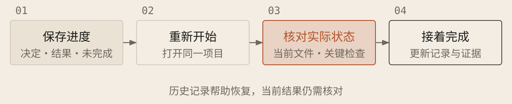

[English](../en/10-long-tasks.md) · [简体中文](../zh/10-long-tasks.md) · [Home](../../README.md)

# 长任务怎样可靠地接着做



长任务靠清晰规格、阶段验收和持续记录衔接。把想法整理成按依赖排序的规格队列，审核后逐项执行。中断、接近用量限制或反复偏离时保存进度，继续前核对状态。

## 保存能被再次核对的分析

一次重要调研、计算或排错结束后，留下问题、关键前提、必要的推导或实验、来源、结论及未确认部分。沿用项目已有的研究文件；记录多了再用简短索引指向各自的主要文件。小改动不必单独建档。这里保存的是 AI 对外给出的可审阅分析，不是模型未展示的内部推理。

例如，调查一个合作方接口时，暂时可访问的契约说明了重试等待值的单位。若以后还要按这个结论写代码，应留下单位换算、适用的主机与请求方式，并保留获准保存的契约原件或长期可访问的出处。只有“上次推断是毫秒”这句话，无法让接手者核对来源。后续任务先读相关记录，再对照当前契约与代码；条件改变就重新验证。

交接前实际打开保存的文件，检查内容和出处。可选的[本地交接包工具](../../skills/project-guide/scripts/handoff_packet.py)能为指定文件生成索引和 SHA-256 摘要，方便发现文件丢失或改变；摘要不判断结论是否正确。交接包默认保存在项目内被 Git 忽略的 `.agent-handoff/`，其中可能有私有资料，公开分享前要单独审核。工具不可用时，给出明确标为未保存的 Markdown 草稿与人工保存步骤。

## 结束前保存，重新开始后核对

`PROGRESS.md` 是文字进度文件，已有记录时沿用。结束前用第一张卡，重开后用第二张。

### 保存进度

```text
请更新[进度文件]：当前目标与决定、项目位置与版本、已改文件和未提交修改、检查及结果位置、失败和未验证项、未完成事项、恢复方法及下一步。无写权限则返回可保存文本，不称已落盘。

关键实验用索引链接假设、条件、结果和证据。重要调查留下可审阅分析及获准保留的原始依据；交接前回读，不把草稿当已保存。过期决定注明替代，保留原要求与证据；列出规格状态和下次检查条件。历史缺失写未知，不把计划写成完成。
```

每完成一个可验收阶段就更新记录。恢复时重读当前规格、进度与相关实验；聊天中的“完成”不能代替可定位的结果。

### 读取进度并继续

```text
读取[进度文件]及需求、方案和任务，核对目录、版本、已有改动与检查。无 Git 则用文件快照核对；记录缺失或不可读先报缺口，不猜进度，不覆盖他人工作。

从最先可执行的未完成事项继续，每段更新实际结果。仅沿用代码、软件、设置与数据均未受影响的结果；不确定则重查，项目规定的完整检查仍须执行。

按[允许修改与运行范围]和[预算]推进；受阻时继续独立可做部分。预算将尽先保存，不能写则返回交接文本。需要改变目标、扩大权限或解决重要未决选择时，暂停相关工作并说明。
```

## 用验收与停止条件约束迭代

让 AI 在预算内反复提出方案、执行、检查并保留有效结果，不能降低验收标准换取成功。达标则完成，预算将尽时保存；重复失败无新证据或遇到未决取舍时暂停相关工作。持续运行不保证收敛，恢复代码也不会撤回外部操作。
