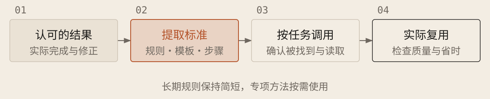

[English](../en/11-rules-and-skills.md) · [简体中文](../zh/11-rules-and-skills.md) · [Home](../../README.md)

# 把有效做法写成规则和技能



遇到重复沟通或反复犯错，适合保存有效做法。安全边界从开始就设定；其他规则从实际问题中提炼。新增规则会增加读取量，不保证更准确，要用新的任务检验。

## 三类内容分别保存

| 保存方式 | 放什么，以及怎样使用 |
| --- | --- |
| 项目规则 | 特殊约定、允许范围、运行与检查入口；沿用 `AGENTS.md` 等工具实际识别的文件，不复制全库概览 |
| Skill 技能 | 反复使用的方法、模板与材料；说明何时调用、输入和预期结果 |
| 自动程序 | 将稳定步骤保存为脚本；要在指定时机自动运行，再接入 Hook（钩子）机制 |

### 整理可复用规则与技能

```text
根据[认可结果、修改记录或重复任务]提取复用要求；允许更新：[文件范围]。沿用规则，重复方法按当前工具规范整理为 Skill，固定步骤适合时写脚本。不支持 Skill 或不能写入时返回文档草稿，不声称已启用。

写明适用条件、输入输出、必要步骤、检查入口和失败处理；第三方技能或脚本先查来源与内容。保留已有有效约定，不新增无关安装。

报告路径与生效方法；需审核、信任或重启时说明。用获准的独立样例检验，无法调用则标未验证。自动检查验证触发及通过、失败、脚本出错时的行为，避免影响真实数据。

比较质量、沟通和返工；仅在允许范围合并重复或过时指导。必须执行的检查不能只靠提示词提醒。
```

## 保存标准，不固定所有思考步骤

从有效做法提炼规则。例如“允许本地提交，未经授权不推送远程仓库”可作项目约定；重复使用的调研方法可整理为 Skill。换一个同类任务检验效果，删除过时指导。

可为工具完成事件配置 Hook，调用脚本保存命令、结果和日志；后台任务另查真实退出状态。命令成功不等于验收通过。仅记录的 Hook 不拦截；需要阻止操作时，核对事前事件与失败处理并实际验证，事后记录不能撤销操作。
